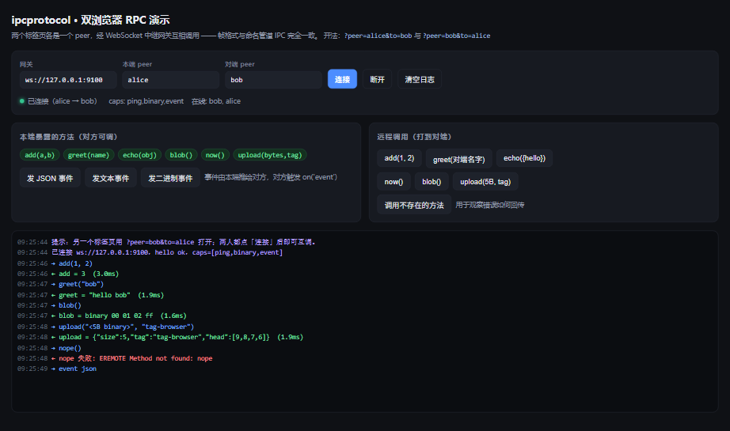

# 浏览器 / WebSocket 互通（可选组件）

把本仓库的 IPC 帧原样搬到 WebSocket 上，让「浏览器 ↔ 浏览器」「浏览器 ↔ 本机进程」也能互相 RPC。
**协议帧一个字节都没改**，`PROTOCOL.md` 与 `tools/dump_parser.js` 依然适用。

```text
浏览器 A ── WsTransport ──┐
                          ├─ ws-relay-gateway.js（只认路由信封，不解析 IPC 帧）──┐
浏览器 B ── WsTransport ──┘                                                │
本机进程（Node/Python/C#…）──────────────────────────────────────────────────┘
```

## 路由信封

网关需要在字节流前面加一层寻址头，格式是固定的 4 段（上下行一致）：

```text
[srcLen u8][src utf8][dstLen u8][dst utf8][原始 IPC 字节...]
```

- 上行时 `src` 由网关用真实 peerId 覆盖（客户端填什么都不采信）；`dst` 是目标 peerId，
  `dstLen=0` 或 `dst="*"` 表示广播给其他所有在线节点。
- 下行时 `src` / `dst` 都由网关填好。
- 信封之外的内容完全不碰，所以一个 IPC 帧被拆成多次写入也不会破坏协议。

> ⚠️ 寻址信息放在传输层，不要塞进 IPC 帧里——那会破坏已发布的多语言实现和抓包工具。

## 文件

| 文件 | 说明 |
|---|---|
| `../ws-relay-gateway.js` | 零依赖 WebSocket 中继网关（自带最小 RFC6455 实现，生产建议换 `ws` 库） |
| `../ws-rpc-demo.js` | 端到端自检：两个 peer 经网关互调 RPC、推事件、传二进制、验证超时 |
| `ws-transport.js` | 传输适配器：把一条 WS 连接伪装成 `net.Socket`（`on`/`write`/`destroy`/`drain`） |
| `mini-stream.js` | 浏览器帧层：纯 `Uint8Array`，无 Node 依赖，线格式与 `MessageStream` 逐字节一致 |
| `mini-rpc.js` | 浏览器 RPC 层：REQUEST/RESPONSE/EVENT/PING/PONG/HELLO/HELLO_ACK + 鉴权 + 二进制请求体 |
| `rpc-protocol-compat.js` | 把上面两层包成 **Node 版 `RpcProtocol` 的接口形状**，业务代码两端一字不改 |
| `rpc-demo.html` | 双浏览器互调演示页（两个标签页各当一个 peer，点按钮互相调） |
| `serve.js` | 零依赖静态服务器（`type=module` 不能用 `file://` 打开，需要它） |

## 跑起来

```powershell
node examples/ws-relay-gateway.js --port 9100     # 启动网关
node examples/ws-rpc-demo.js                      # 端到端自检（会自己起网关，11 项断言）
curl http://127.0.0.1:9100/peers                  # 查看在线节点

node examples/browser/serve.js 8080               # 静态服务（演示页用）
# 浏览器开两个标签页：
#   http://127.0.0.1:8080/examples/browser/rpc-demo.html?peer=alice&to=bob
#   http://127.0.0.1:8080/examples/browser/rpc-demo.html?peer=bob&to=alice
# 两边各点一次「连接」，然后随便点远程调用按钮
```

演示页里每个标签页同时是**服务端和客户端**：它注册了 `add/greet/echo/blob/now/upload`，
对方可以直接调过来；反过来也能调对方的方法、互发 JSON/文本/二进制事件。

## Node 侧直接复用现有实现

适配器暴露的是 `net.Socket` 的形状，所以 Node 里可以原样套 `MessageStream + RpcProtocol`：

```js
import { WsTransport } from './browser/ws-transport.js';
import { MessageStream } from '../MessageStream.js';
import { RpcProtocol } from '../RpcProtocol.js';

const link = new WsTransport('ws://127.0.0.1:9100', { peer: 'alice', to: 'bob' });
await new Promise((r) => link.once('open', r));
const rpc = new RpcProtocol(new MessageStream({ socket: link }), { authToken: token });
await rpc.hello();
console.log(await rpc.sendRequest('add', [1, 2]));
```

## 浏览器侧：用 mini 栈（无需 Node 运行时）

浏览器没有 `Buffer` / `net`，**不能直接用 Node 版 `MessageStream`**（它依赖 `Buffer.copy`）。
所以这里配了一套同线格式的前端精简栈，纯 `Uint8Array`，走浏览器原生 `WebSocket`：

```js
import { WsTransport } from './ws-transport.js';
import { MiniMessageStream } from './mini-stream.js';
import { MiniRpc } from './mini-rpc.js';

const link = new WsTransport('ws://127.0.0.1:9100', { peer: 'alice', to: 'bob' });
const stream = new MiniMessageStream(link);          // 帧层：分帧 + CRC32 + 错误包 + 重同步
const rpc = new MiniRpc(stream, { implName: 'browser/alice' }); // 报文层：配对/超时/心跳/鉴权

rpc.registerMethod('add', (a, b) => a + b);          // 本端可被对方调用
rpc.on('event', (msg) => console.log('对端推来的事件', msg.content));

await rpc.hello();                                   // HELLO / HELLO_ACK 能力协商
console.log(await rpc.sendRequest('add', [1, 2]));   // → 3
await rpc.sendRequestBinary('upload', new Uint8Array([1, 2, 3]), 'tag');
```

两边实现可以任意混搭（已实测互通）：

| 组合 | 状态 |
|---|---|
| mini（浏览器） ↔ Node `RpcProtocol` | ✅ 双向调用、事件、二进制、错误、心跳 |
| mini（浏览器） ↔ mini（浏览器） | ✅ 同上 |
| Node `MessageStream` ↔ WS / 命名管道 / TCP | ✅ 原样支持 |

## 同一套写法：compat 层（推荐业务代码用它）

`mini-stream.js` + `mini-rpc.js` 是「两层分开」的低层 API。如果希望**前端和 Node 端的业务代码一字不改**，
用 `rpc-protocol-compat.js`：它把这两层包成 Node 版 `RpcProtocol` 的接口形状，两端只差一行 import。

```js
// Node 端（进程 / 子进程 / 本机服务）
import { RpcProtocol, RpcError } from '../../RpcProtocol.js';
// 浏览器端
import { RpcProtocol, RpcError } from './rpc-protocol-compat.js';

// ——— 下面这部分两端完全相同 ———
const rpc = new RpcProtocol(stream, { authToken, implName: 'demo', heartbeatIntervalMs: 5000 });
rpc.registerMethod('add', (a, b) => a + b);
rpc.handlers.mul = (a, b) => a * b;          // handlers 对象写法也支持
rpc.on('event', (msg) => console.log(msg.contentType, msg.content));
rpc.on('error', (err) => console.warn(err.code));

await rpc.hello();
console.log(await rpc.sendRequest('add', [1, 2]), await rpc.sendRequestBinary('upload', bytes, 'tag'));
```

对齐的东西：构造参数字段名与默认值、`hello/sendRequest/sendRequestBinary/sendResponse/sendRaw/onEvent/
registerMethod/sendText/sendJson/sendBinary/destroy/setRequiredTokens/handleMessage`、
`handlers`（普通对象，内部同步给 mini 层）、`pendingRequests`、`peerCapabilities`、`serverCapabilities`、
`heartbeatDisabledReason` 等属性、`'event' / 'error' / 'heartbeatDisabled'` 事件、
以及静态的 `TYPES / CONTENT_TYPES / serialize / deserialize / encodeBinaryRequest / decodeBinaryRequest`。

无法对齐的部分（浏览器环境固有限制，不是 bug）：

| 差异 | 说明 |
|---|---|
| 二进制容器 | 浏览器里是 `Uint8Array`（没有 `Buffer`），Node 侧拿到 `Buffer` |
| `sendRequest` 的 `to` | 被忽略。IPC 帧没有目标地址，路由由 WS 网关的传输层信封负责 |
| 对端数量 | 一条链路一个对端；Node 版可做多客户端路由 |
| `heartbeatSkipWhilePending` | 恒为 `true`（有在途请求不判超时），设置 `false` 会打一条警告 |
| token 轮换 | `setRequiredTokens` 立即整体替换，没有宽限期语义 |
| `RpcError.data` | 远程错误只保留 `code='EREMOTE'` 与 message，不带 `data` |

已用同一段 scenario 代码分别跑 Node 版与 compat 版，逐项比对 29 个观察点全部一致；
另在真实 WS 链路（compat ↔ Node 原版）上验证 13 项：握手、双向调用、二进制、`handlers` 写法、
错误传播、超时、事件、跨心跳保活、静态编解码。

## 双浏览器互调演示

`rpc-demo.html` 就是 compat 层的可视化版（页面里的调用代码与 Node 示例完全一致，
差别只有 `import { RpcProtocol } from './rpc-protocol-compat.js'` 这一行），两个标签页互相调：

```powershell
node examples/ws-relay-gateway.js --port 9100
node examples/browser/serve.js 8080
```

- 标签页 A：`.../rpc-demo.html?peer=alice&to=bob`
- 标签页 B：`.../rpc-demo.html?peer=bob&to=alice`
- 各自点「连接」，然后在「远程调用」里点 `add(1,2)`、`blob()`、`upload(5B, tag)` 等按钮，
  日志区会显示往返耗时；点「发 JSON 事件」对方会立刻收到。

页面上的每个节点都同时注册了 `add/greet/echo/blob/now/upload` 六个方法，
可以两个标签页各点一下对方的按钮，观察双向调用。



## 已知边界

1. **一个适配器 = 一条「本端 ↔ 某对端」链路**。要和 N 个对端通信，就开 N 个适配器（各自一个 `RpcProtocol`）。
   IPC 帧里没有目标地址，只能在传输层定向。
2. **目标不在线时网关直接丢弃**，不伪造错误响应（伪造会污染协议流），由调用方的请求超时兜底。
3. **`autoReconnect` 默认关闭**。浏览器要开的话，重连后旧的 `MessageStream` / `RpcProtocol` 状态已失效，
   必须整条重建再重新 `hello()`。
4. **没有 TLS**：`ws://` 明文，只适合本机或受信内网；跨机请用 `wss://` 或 SSH 隧道（同 `SECURITY.md`）。
5. **写入粒度不同**：Node 版 `MessageStream` 会把一帧拆成 head / payload / tail 三次 `write`，
   即 3 条 WS 消息、3 个信封头；`mini-stream.js` 整帧合并成一次 `write`。正确性都不受影响。
6. **`/peers` 允许跨源读取**（`access-control-allow-origin: *`），因为演示页通常在 `:8080`、
   网关在 `:9100`，属于不同源。只暴露 peerId 与计数，不含业务数据。
